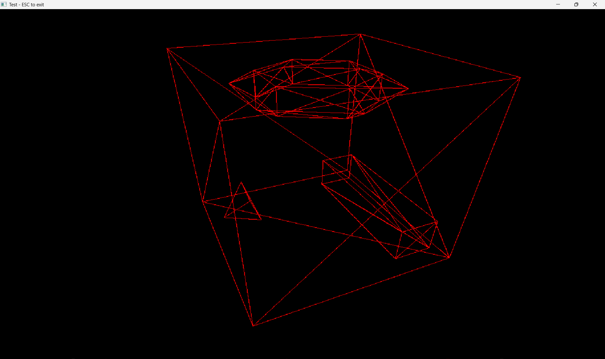

# Rust CPU 3D Graphics

This Rust project draws a 3D wireframe scene using a custom wireframe rasterizer. Displays image on a windowed frame buffer using the minifb crate.

## Features
- 3D triangle rasterizer with perspective projection
- windowed display
- Keyboard controls for camera movement

## Dependencies
- Rust (>=1.56.0)
- Cargo
- minifb

## Building and Running

1. Clone the repository
2. Run `cargo run`

## Controls
- W/S: Move forward/backward
- A/D: Strafe left/right
- E/Q: Move up/down
- Arrow keys: Look left/right/up/down
- ESC: Exit

## Project Structure
- `src/main.rs`: Main application
- `src/camera.rs`: Camera module
- `src/obj.rs`: 3D object module
- `src/math.rs`: Vector math
- `src/color.rs`: Color definitions
- `src/pen.rs`: Drawing utilities